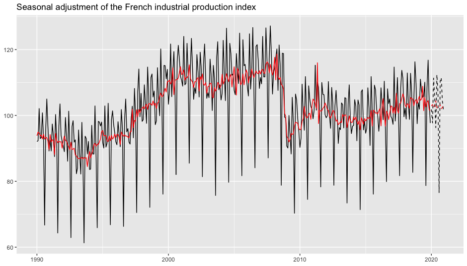
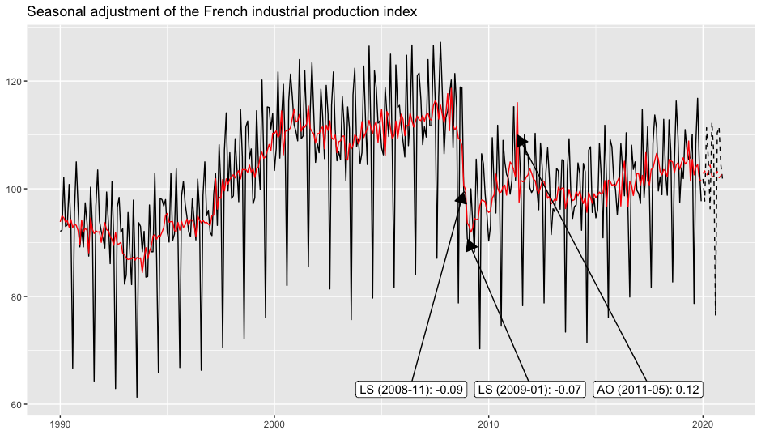
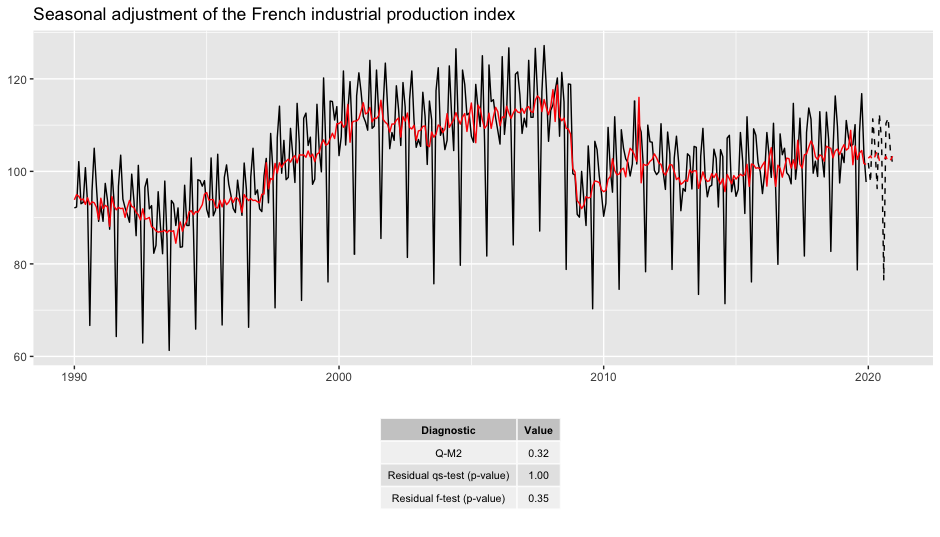
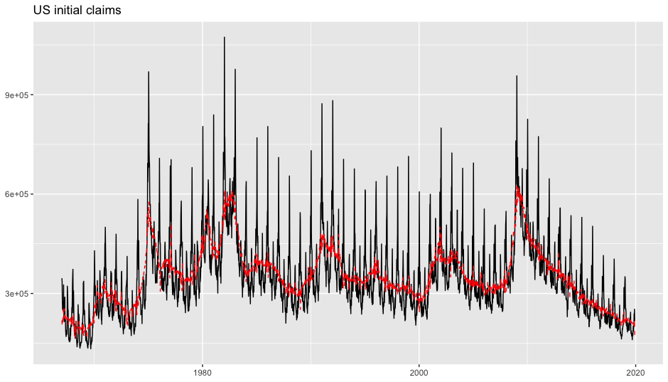
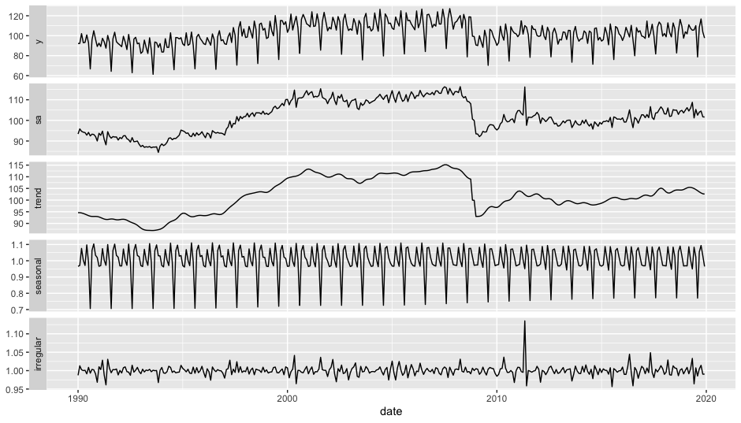
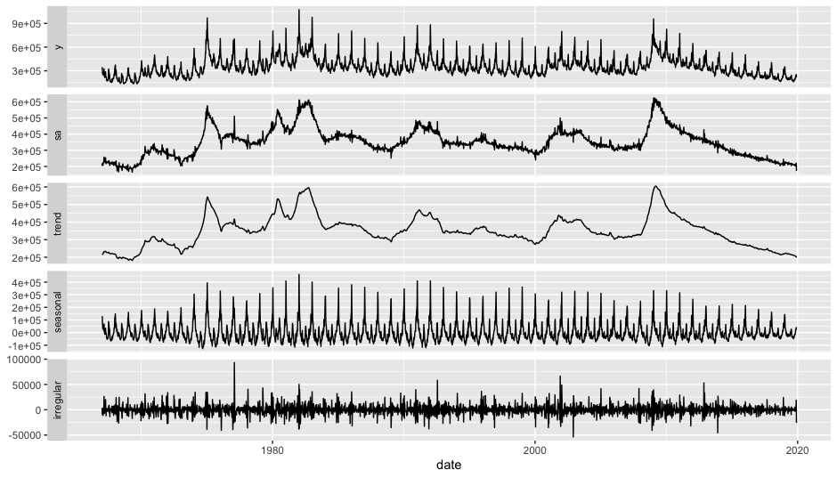
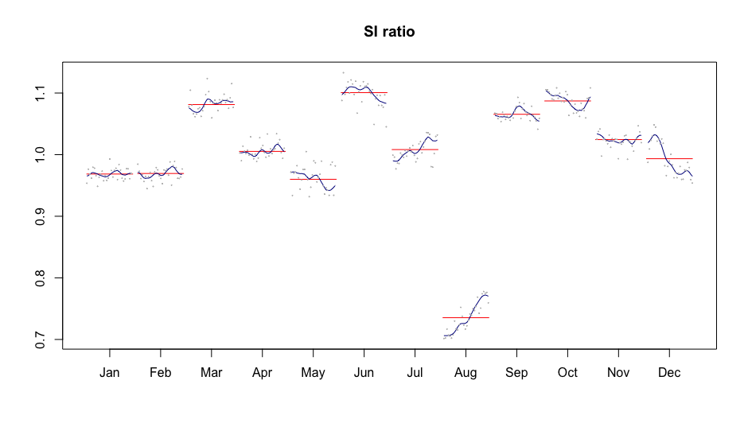

# ggdemetra3

[](https://github.com/AQLT/ggdemetra3/actions)
[](https://aqlt.r-universe.dev/ggdemetra3)

`ggdemetra3` is an extension of
[ggplot2](https://github.com/tidyverse/ggplot2) to add seasonal
adjustment statistics to your plots. The seasonal adjustment process is
performed using the [R packages associated with version 3 of
JDemetra+](https://github.com/rjdverse), which is the seasonal
adjustment software officially recommended for members of the European
Statistical System (ESS) and the European System of Central Banks.
[`rjd3x13`](https://github.com/rjdverse/rjd3x13) is used for X-13,
[`rjd3tramoseats`](https://github.com/rjdverse/rjd3tramoseats) for
TRAMO-SEATS, and
[`rjd3highfreq`](https://github.com/rjdverse/rjd3highfreq) for
high-frequency seasonal adjustment methods. In addition, `ggdemetra3`
provides functions to visualize linear filters, weights, and trend-cycle
estimation tools from the
[`rjd3filters`](https://github.com/rjdverse/rjd3filters) infrastructure.

## Installation

Since `rjdverse` packages require Java SE 17 or a later version, the
same requirements are also needed for `ggdemetra3`.

To install the developpment version:

- From [r-universe](https://aqlt.r-universe.dev/rjd3filters):

``` r

install.packages("ggdemetra3", repos = c("https://aqlt.r-universe.dev", "https://cloud.r-project.org"))
```

- From GitHub:

``` r

# install.packages("remotes")
remotes::install_github("AQLT/ggdemetra3")
```

If you encounter issues with the installation of `ggdemetra3`, check the
[installation
manual](https://github.com/rjdverse/rjdemetra/wiki/Installation-manual).

## Usage

By default, the seasonal adjustment is performed using X-13-ARIMA with
the predefined specification `"RSA5c"` (automatic log detection,
automatic ARIMA and outlier detection, and trading day and Easter
adjustments). If no new data or seasonal adjustment specification
(method or spec) is provided, these parameters are inherited from the
previously defined ones; therefore, you only need to specify the
specification once. In the following examples, the seasonal adjustment
will be performed with X-13-ARIMA with working day adjustment and no
gradual Easter effect adjustment (which is the specification that makes
the most economic sense for the industrial production index).

To add the seasonally adjusted series, along with forecasts of the input
data and the seasonally adjusted series:

``` r

library(ggdemetra3)
spec <- rjd3x13::spec_x13("rsa3")
spec <- rjd3toolkit::set_tradingdays(spec, option = "WorkingDays")
p_ipi_fr <- ggplot(data = ipi_c_eu_df, mapping = aes(x = date, y = FR)) +
    geom_line() +
    labs(title = "Seasonal adjustment of the French industrial production index",
         x = NULL, y = NULL)
p_sa <- p_ipi_fr +
    geom_sa(component = "y_f(12)", linetype = 2,
            spec = spec) + 
    geom_sa(component = "sa", color = "red") +
    geom_sa(component = "sa_f", color = "red", linetype = 2)
p_sa
```



To add the outliers at the bottom of the plot with an arrow pointing to
the data point and displaying the estimated coefficients:

``` r

p_sa + 
    geom_outlier(geom = "label_repel",
                 coefficients = TRUE,
                 ylim = c(NA, 65), force = 10,
                 arrow = arrow(length = unit(0.03, "npc"),
                               type = "closed", ends = "last"),
                 digits = 2)
```



To add the ARIMA model:

``` r

p_sa + 
    geom_arima(geom = "label",
               x_arima = -Inf, y_arima = -Inf, 
               vjust = -1, hjust = -0.1)
```


To add a table of diagnostics below the plot:

``` r

diagnostics <- c(`Q-M2` = "m-statistics.q-m2",
                 `Residual qs-test (p-value)` = "diagnostics.seas-sa-qs",
                 `Residual f-test (p-value)` = "diagnostics.seas-sa-f")
p_diag <- ggplot(data = ipi_c_eu_df, mapping = aes(x = date, y = FR)) +
    geom_diagnostics(diagnostics = diagnostics,
                     table_theme = gridExtra::ttheme_default(base_size = 8),
                     message = FALSE) + 
    theme_void()
    
gridExtra::grid.arrange(p_sa, p_diag,
    nrow = 2, heights = c(4, 1.5))
```



See the
[vignette](https://aqlt.github.io/ggdemetra3/articles/ggdemetra3.html)
for more details.

Note that `ts` objects cannot be directly used in `ggplot2`. To convert
a `ts` or `mts` object to a `data.frame`, you can use the
[`ts2df()`](https://aqlt.github.io/ggdemetra3/reference/ts2df.md)
function.

``` r

ipi_c_eu_df <- ts2df(ipi_c_eu)
```

## High-Frequency Seasonal Adjustment

The
[`geom_sa()`](https://aqlt.github.io/ggdemetra3/reference/geom_sa.md)
function is also compatible with methods used for high-frequency
seasonal adjustment (`"x11-extended"`, `"fractionalairline"`,
`"multiairline"`, or `"stl"`).

``` r

p_us_init_claims <- ggplot(data = usclaims[usclaims$date <= "2019-12-01",], mapping = aes(x = date, y = `Initial claims`)) +
    geom_line() +
    labs(title = "US initial claims",
         x = NULL, y = NULL)
p_sa <- p_us_init_claims +
    geom_sa(component = "sa", linetype = 2, frequency = 52,
            method = "multiairline",
            col = "red") 
p_sa
```



## autoplot()

The different components of seasonal adjustment models can also be
extracted through
[`calendar()`](https://aqlt.github.io/ggdemetra3/reference/components.md),
[`calendaradj()`](https://aqlt.github.io/ggdemetra3/reference/components.md),
[`irregular()`](https://aqlt.github.io/ggdemetra3/reference/components.md),
[`trendcycle()`](https://aqlt.github.io/ggdemetra3/reference/components.md),
[`seasonal()`](https://aqlt.github.io/ggdemetra3/reference/components.md),
[`seasonaladj()`](https://aqlt.github.io/ggdemetra3/reference/components.md),
and
[`raw()`](https://aqlt.github.io/ggdemetra3/reference/components.md).

`ggdemetra3` also provides
[`autoplot()`](https://ggplot2.tidyverse.org/reference/autoplot.html)
methods to plot seasonal adjustment models:

``` r

mod <- rjd3x13::x13(ipi_c_eu[, "FR"])
autoplot(mod)
```



``` r


mod_hf <- rjd3highfreq::fractional_airline_decomposition(
    usclaims[usclaims$date <= "2019-12-01", "Initial claims"], 
    period = 52)
autoplot(mod_hf, dates = usclaims$date[usclaims$date <= "2019-12-01"])
```



For X-13 and TRAMO-SEATS, the SI ratio can also be plotted using the
[`siratioplot()`](https://aqlt.github.io/ggdemetra3/reference/siratio.md)
and
[`ggsiratioplot()`](https://aqlt.github.io/ggdemetra3/reference/siratio.md)
functions:

``` r

siratioplot(mod)
```



## Summary of Functions

`ggdemetra3` provides a comprehensive set of tools for seasonal
adjustment visualization and component extraction:

[TABLE]

## Licensing

The code of this project is licensed under the [European Union Public
Licence
(EUPL)](https://interoperable-europe.ec.europa.eu/collection/eupl/eupl-text-eupl-12).
